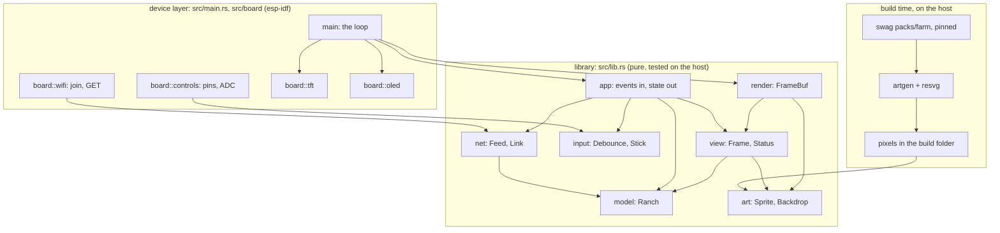

# Firmware architecture (#2)

## Summary

Decision: One library that builds and tests on a laptop (model, link, input, view, render, art) and a thin device
layer for pins, screens and Wi-Fi. It polls drover every 5 s, marks the scene stale after 20 s and swaps it for
"no drover" after 5 min. The build turns swag's pinned farm pack into pixels; the chip never reads SVG.
Slices: display bring-up, model and art, scene render, Wi-Fi polling, input: five issues in that order.
Open questions: the Wi-Fi password is baked into the firmware from build-time variables (readable from the board);
the plan adds six libraries (ADR section 9). Approve both, or say which to change.

## Files

| File | What it holds |
|---|---|
| [adr.md](adr.md) | the question, the options, the decisions, the consequences, the `arch.toml` lines |
| [usage.md](usage.md) | how `main`, a test and the build script read; start here for the feel of it |
| [shapes.md](shapes.md) | the JSON the device reads, its model, the display list, the art, the events |
| [states.md](states.md) | the link, the screen mode and the joystick as statecharts |
| [milestones.md](milestones.md) | issues M2–M6, each with its AC, size and the files it owns |

## Modules

An arrow is "may call". Anything not drawn is not allowed.

| Module | Its job | May use | Enforced by |
|---|---|---|---|
| `model` | bytes to `Snapshot`: the one place JSON is read | `blocks`, `serde` | review |
| `net` | `Feed`: a body to a `Poll` (same, new, failed) and the retry delay. `Link`: fresh, stale, lost from the last good poll's time | `model` | ban on `esp_idf` |
| `input` | `Debounce`, `Stick`: raw reads to `Input` events | nothing | ban on `esp_idf` |
| `art` | the built pixels and their types | nothing | ban on `esp_idf` |
| `view` | `Snapshot` + mode + link to `Frame` (TFT) and `Status` (OLED); cuts every text to fit | `model`, `art` | ban on `esp_idf` |
| `render` | `Frame` to `FrameBuf` pixels; `Status` to a 1-bit target | `view`, `art`, `embedded-graphics` | ban on `crate::model` |
| `app` | the reducer: one `Event` in, new state, what is dirty | `model`, `net`, `input`, `view` | ban on `esp_idf` |
| `board` | pins, SPI, I2C, ADC, PWM, Wi-Fi, HTTP; the two threads | the library, `esp-idf-svc`, `mipidsi`, `ssd1306` | GPIO numbers only in `pins.rs` |
| `main` | wiring: channel, threads, the loop | `board`, `app`, `render` | 80-line limit |

The library never names esp-idf, so `cargo test` and `cargo run --example shot` run it whole on the host.

## Threads

| Thread | Owns | Sends |
|---|---|---|
| main (UI) | `App`, `FrameBuf`, both screens, the LED | – |
| net, 32 KB stack | Wi-Fi, the HTTP client, the `Feed` | `Event::Poll` (blocks when the queue is full) |
| input, 4 KB stack | the button pins and the ADC, read every 5 ms | `Event::Input` (dropped when the queue is full) |

One bounded channel of 16 `Event`s joins them. Nothing else is shared: no lock, no global.
