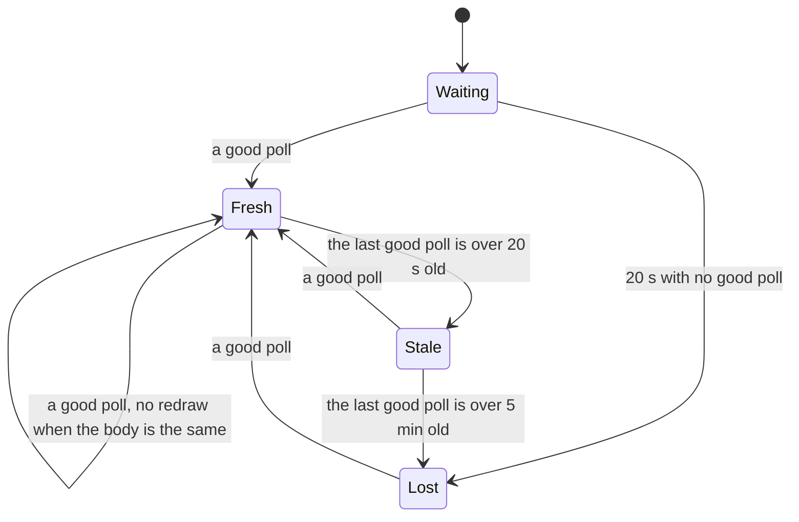
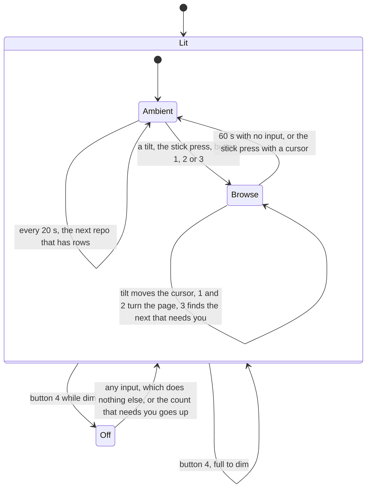
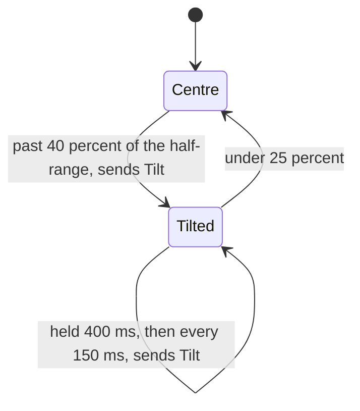

# Statecharts (#2)

Each chart is one plain type in the library, with the time passed in. None reads a clock, a pin or a socket, so
each is tested on the host with scripted input.

## 1. The link (`net::Link`)

| State | TFT | OLED, first line |
|---|---|---|
| Waiting | the loading horse, "saddling up" | `joining wifi` |
| Fresh | the scene | `fresh 3s` |
| Stale | the scene, with an amber `stale 45s` in the header | `stale 45s: timeout` |
| Lost | the loading horse, "no drover" and the reason | `no drover: no wifi` |

- The state is not stored. `Link` keeps the time of the last good poll and the last failure's reason, and
  `state(now)` reads the chart off them; the UI thread asks once a second.
- A good poll is a 200 whose body parses, or equals the last good body.
- A failed poll is anything else, each with its reason: `not configured`, `no wifi`, `refused`, `timeout`,
  `http 403` (the `Host` guard), `http 404` (wrong path, or the listener is off), `too big`, `bad data`.
- The wait after a good poll is 5 s. After failures in a row it is 5, 10, 20, 40, then 60 s; a good poll resets it.
  Joining Wi-Fi is part of the poll, so it backs off the same way.
- The age on screen counts up from the last good poll every second, without a poll.

## 2. The screen mode (`app::Mode`) and the backlight

- **Ambient:** no cursor. It starts on the first repo with a row that needs you, else the first with rows.
- **Browse:** the cursor is on a row or on none. A tilt with no cursor picks the first horse. A tilt moves to the
  nearest item whose centre lies in that direction, and stays put when there is none. Button 3 goes through the
  rows that need you in the order drover sent them, across repos, and wraps; with none, the caption says so.
- **Off:** backlight and OLED dark; polling goes on, and so does the LED.
- A new snapshot never changes the mode. The cursor follows its row by id.

## 3. One joystick axis (`input::Stick`)

When both axes are tilted the larger one wins. The centre is the mean of 32 reads at boot; a mean outside 35–65 %
of the range (the stick was held) falls back to the middle. A button is the same chart without the repeat: a
change counts after 4 equal reads 5 ms apart, and only the press sends.
