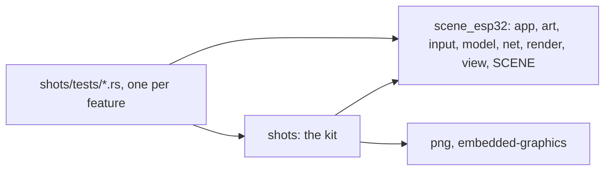

# Hot files: the screenshot script and the library's module list (#15)

## Summary

Decision: The one screenshot script becomes a small host-only crate where each feature adds its own file; the
normal test run writes the same 15 pictures, so CI loses a step. The library's module list is frozen at its seven
modules: new code goes inside a module's folder, never into the list.
Slices: one PR in two commits: the screenshot crate (the old script deleted), then the freeze (one dead constant
removed).
Open questions: none.

## Files

| File | What it holds |
|---|---|
| [adr.md](adr.md) | the question, what was checked by a run, the options, the decision, the consequences, the AC, the `arch.toml` lines |
| this file | how a screenshot file reads, the shapes, who may call whom |

## Usage first: a feature's screenshots

A feature that changes what a screen shows adds one file, `shots/tests/<feature>.rs`, and edits no shared file.
Cargo finds it by its folder. `shots/tests/link.rs`, whole:

```rust
use std::time::Duration;

use scene_esp32::net::{Fail, LinkState};
use scene_esp32::view::{self, Mode};
use shots::{fixture, oled, tft, AT};

#[test]
fn stale_and_lost() {
    let snapshot = fixture();
    let ambient = Mode::Ambient { page: 0 };
    let stale = LinkState::Stale {
        age: Duration::from_secs(45),
        why: Fail::Timeout,
    };
    let lost = LinkState::Lost { why: Fail::NoWifi };
    for (name, link) in [("stale", stale), ("lost", lost)] {
        tft(name, &view::frame(Some(&snapshot), &ambient, &link, AT));
        let status = view::status(Some(&snapshot), &ambient, &link, AT);
        oled(&format!("oled-{name}"), &status);
    }
}
```

A screenshot that needs the reducer drives it, as `shots/tests/browse.rs` does:

```rust
#[test]
fn browse() {
    let mut app = App::new();
    app.on(Event::Poll(Poll::New(fixture())), AT);
    for dir in [Dir::Up, Dir::Left] {
        app.on(Event::Input(Input::Tilt(dir)), AT);
    }
    tft("browse", &app.frame().expect("a browse frame"));
    oled("oled-horse", &app.status().expect("the horse page"));
}
```

The commands (a host triple as today, e.g. `aarch64-apple-darwin`):

```sh
cargo test --workspace --target <host>          # everything; writes target/shots/*.png (CI's line, unchanged)
cargo test -p shots --target <host>             # the pictures only
cargo test -p shots --test link --target <host> # one file's pictures
```

## Shapes

The layout after the PR:

```
shots/
  Cargo.toml       a workspace member, host only
  src/lib.rs       the kit: about 45 lines, moved from examples/shot.rs
  tests/
    scene.rs       scene-<repo> (5), loading, storm-fog, oled-idle
    link.rs        stale, lost, oled-stale, oled-lost
    browse.rs      browse, oled-horse
    art.rs         art
examples/          gone
```

The kit, `shots/src/lib.rs`. It draws with the library's own `render` and panics, naming the path, when a file
cannot be written:

```rust
/// The time after boot every still is taken at.
pub const AT: Duration = Duration::from_millis(1200);

/// The checked-in scene, parsed.
pub fn fixture() -> Snapshot;

/// Draws `frame` as the TFT does and writes `target/shots/<name>.png` (320×240).
pub fn tft(name: &str, frame: &Frame);

/// Draws `status` as the OLED does and writes `target/shots/<name>.png` (128×64).
pub fn oled(name: &str, status: &Status);

/// Writes `px`, `width` pixels to a row, as `target/shots/<name>.png`.
pub fn sheet(name: &str, width: usize, px: &[Rgb565]);
```

`shots/Cargo.toml`. `png` moves here from the root's `[dev-dependencies]`; no library is new:

```toml
[package]
name = "shots"
version = "0.1.0"
edition = "2021"
license = "MIT"
publish = false

[lib]
test = false
doctest = false

[dependencies]
embedded-graphics = "0.8"
png = "0.18"
scene-esp32 = { path = ".." }
```

The root `Cargo.toml`: `members = ["artgen", "shots"]`, and `[dev-dependencies]` goes.

`src/lib.rs` after the PR, then frozen: the panel-feature check, the seven `pub mod` lines and `SCENE`. `PANEL`
goes: nothing has read it since milestone 4 dropped the boot frame.

## Who may call whom



| Part | May use | Enforced by |
|---|---|---|
| `shots/tests/<feature>.rs` | the kit, the library's public API; never another test file | Cargo: each file is its own program |
| `shots` (the kit) | the library's public API, `png`, `embedded-graphics` | the `esp_idf` ban, now on `shots/**` |
| the library, the firmware | never `shots` or `png` | Cargo: `shots` depends on the library, so the reverse is a cycle |
| `src/lib.rs` | its seven modules; no new line | `frozen` |
| a library module's new file | what its module may use (the firmware ADR's table) | that module's own `mod` line and the existing bans |

## State

None: a screenshot is a pure function of the fixture, a mode, a link state and a time. No statechart.
